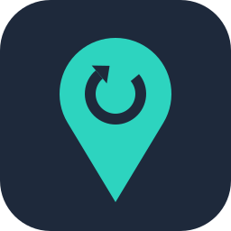

<p align="center">
  
</p>

<h1 align="center">No Fixed Address</h1>

<p align="center">
  Self-hosted dynamic DNS for Cloudflare DNS.<br>
  A small container that keeps your A and AAAA records pointed at your current public IP address.
</p>

<p align="center">
  <a href="https://github.com/mdr6273/no-fixed-address/actions/workflows/ci.yml"></a>
  <a href="LICENSE"></a>
</p>

---

## Why

Home internet connections rarely have a fixed IP address, so a name like
`home.example.com` stops working the next time your ISP hands you a new one.
Free dynamic DNS services solve that until they don't: hostnames lapse unless
you log in to confirm them every month, free tiers shrink, and the service in
the middle is one more account that has to stay alive.

If your domain's DNS is already on Cloudflare, you don't need that service.
Cloudflare's API can update the record directly, and an API token doesn't
expire unless you tell it to. No Fixed Address does exactly that, and nothing
else:

- **Set and forget.** Checks when it starts and then once a day (configurable), and only writes when the address has actually changed.
- **IPv4 and IPv6.** Any number of names in one zone, including the zone apex and wildcards.
- **Leaves your settings alone.** Proxy status and TTL are preserved unless you ask it to manage them.
- **Least privilege.** One API token limited to one zone, a non-root container, and the token is never logged or put on a command line.
- **Rides out outages.** Network and API failures are retried with backoff, from one minute up to an hour. It never crash-loops.
- **Tells you when it's stuck.** A Docker health check turns unhealthy when updates stop succeeding.
- **Small.** A POSIX shell script with curl and jq on Alpine, for amd64 and arm64.

## How it works

1. At startup it checks every setting, verifies the API token with Cloudflare and looks up the zone. Bad settings stop the container with a message saying what to fix.
2. It finds the public address by asking `https://1.1.1.1/cdn-cgi/trace`, falling back to `api.ipify.org` and `ifconfig.me`. IPv6 uses `[2606:4700:4700::1111]/cdn-cgi/trace` and `api6.ipify.org`. Answers are strictly validated, and private or reserved addresses are rejected, so a failed or garbled lookup can't put a nonsense address in your DNS. Validation can't prove an address is really yours, which is why every default service uses HTTPS.
3. It compares the address with each record and updates only the ones that differ.
4. It sleeps until the next check. If something failed along the way, it retries after 60 seconds, then 2 minutes, then 4, up to an hour, until a check succeeds.

## Quick start

1. [Create a scoped API token](#creating-the-cloudflare-api-token).
2. Try it without changing anything:

   ```sh
   docker run --rm \
     -e CF_API_TOKEN=your-token \
     -e CF_ZONE=example.com \
     -e CF_RECORDS=home.example.com \
     -e DRY_RUN=true \
     ghcr.io/mdr6273/nofixedaddress:latest
   ```

   It logs what it would change, then waits for the next check. Press Ctrl+C to stop it.
3. Run it for real with `DRY_RUN` removed, using [docker run](#docker-run), [Docker Compose](#docker-compose) or the [Unraid template](#unraid).

## Creating the Cloudflare API token

The container needs an API token that can read your zone and edit its DNS
records. Limit it to the one zone so that, if it ever leaked, nothing else in
your Cloudflare account would be exposed.

1. Log in to the [Cloudflare dashboard](https://dash.cloudflare.com/), open **My Profile** from the account menu, and choose **API Tokens**.
2. Select **Create Token**, then **Create Custom Token** (**Get started**).
3. Give it a name you'll recognise later, such as `No Fixed Address (home server)`.
4. Under **Permissions**, add two rows:
   - **Zone** / **DNS** / **Edit**
   - **Zone** / **Zone** / **Read**
5. Under **Zone Resources**, choose **Include** / **Specific zone** / your domain.
6. Leave **Client IP Address Filtering** empty. Your IP address is the thing that changes, so a filter would eventually lock the container out.
7. Leave the **TTL** (token expiry) empty, or set an end date and remember to replace the token before then.
8. Select **Continue to summary**, then **Create Token**, and copy the token. Cloudflare shows it only once.

Check that the token works before using it:

```sh
curl -s -H "Authorization: Bearer your-token" \
  https://api.cloudflare.com/client/v4/user/tokens/verify
```

The response should include `"status":"active"`.

Use an API token, not your Global API Key. An account-owned token, created
with the same permissions on the account's own **API Tokens** page, works as
well. Cloudflare verifies those at a different endpoint, so the `curl` check
above reports them as invalid, but the container recognises and verifies them
either way.

## Unraid

1. Open a terminal on the server (the `>_` icon in the web UI) and download the template:

   ```sh
   wget -O /boot/config/plugins/dockerMan/templates-user/my-NoFixedAddress.xml \
     https://raw.githubusercontent.com/mdr6273/no-fixed-address/main/unraid/nofixedaddress.xml
   ```

2. On the **Docker** tab, select **Add Container**, and choose **NoFixedAddress** from the **Template** list (under user templates).
3. Fill in **Cloudflare API token**, **Zone** and **Records**. Records are full names, such as `home.example.com`, not just `home`. For the first start, set **Dry run** to `true`.
4. Select **Apply**, then open the container's log from its icon on the Docker tab. It should show the token being verified and what it would change.
5. When the log looks right, edit the container, set **Dry run** back to `false`, and apply.

Notes for Unraid:

- **Keep the token out of screenshots:** the window Unraid shows after **Apply** prints the whole `docker run` command, token included. Blank it out before sharing that window, for example when asking for help.
- **Updates:** when a new version is published, the Docker tab shows an update for the container. Apply it from there, after reading the [changelog](CHANGELOG.md).
- **Time zone:** Unraid passes your server's time zone to every container, so log timestamps already match it. The template has no `TZ` field on purpose, because a blank one would override that.
- **IPv6:** the default bridge network has no IPv6. To update AAAA records, set **Network Type** to **Host**, or use a custom network with IPv6 enabled.
- **Advanced settings:** TTL, log level, a token file and the lookup URLs are under **Show more settings**.

## docker run

```sh
docker run -d \
  --name nofixedaddress \
  --restart unless-stopped \
  -e CF_API_TOKEN=your-token \
  -e CF_ZONE=example.com \
  -e CF_RECORDS=home.example.com,vpn.example.com \
  -e TZ=America/Chicago \
  ghcr.io/mdr6273/nofixedaddress:latest
```

`latest` follows the newest release, and each release is also published under
its exact version, such as `0.0.1`. Until 1.0.0, any release may change
behaviour, so pin an exact version if you'd rather upgrade on your own
schedule, and read the [changelog](CHANGELOG.md) before moving to a new one.

## Docker Compose

See [docker-compose.example.yml](docker-compose.example.yml) for a complete
file, including a read-only, unprivileged container. The short version:

```yaml
services:
  nofixedaddress:
    image: ghcr.io/mdr6273/nofixedaddress:latest
    restart: unless-stopped
    environment:
      CF_API_TOKEN: ${CF_API_TOKEN}   # from a .env file next to the compose file
      CF_ZONE: example.com
      CF_RECORDS: home.example.com,vpn.example.com
      TZ: America/Chicago
```

### Keeping the token out of `docker inspect`

Anything passed with `-e` or `environment:` shows up in `docker inspect`. To
avoid that, put the token in a file and point `CF_API_TOKEN_FILE` at it, for
example with a Compose secret:

```yaml
services:
  nofixedaddress:
    image: ghcr.io/mdr6273/nofixedaddress:latest
    restart: unless-stopped
    environment:
      CF_API_TOKEN_FILE: /run/secrets/cf_api_token
      CF_ZONE: example.com
      CF_RECORDS: home.example.com
    secrets:
      - cf_api_token

secrets:
  cf_api_token:
    file: ./cf_api_token.txt
```

The container runs as uid 10001, so the file must be readable by that user.
Make it readable by no one else, since anyone who can read it can change
every record in the zone:

```sh
sudo chown 10001:10001 cf_api_token.txt
sudo chmod 0400 cf_api_token.txt
```

## Configuration

| Variable | Default | Description |
| --- | --- | --- |
| `CF_API_TOKEN` | *required* | The [scoped API token](#creating-the-cloudflare-api-token). |
| `CF_API_TOKEN_FILE` | | Path to a file containing the token, such as a Docker secret. Use instead of `CF_API_TOKEN`, not as well. |
| `CF_ZONE` | *required* | The zone the records belong to, such as `example.com`. |
| `CF_RECORDS` | *required* | Comma-separated full names to keep updated, such as `home.example.com,vpn.example.com` (not just `home`). Use `@` for the zone itself; wildcards such as `*.example.com` work too. Often one name is enough: see [Pointing more names at it](#pointing-more-names-at-it). |
| `INTERVAL` | `86400` | Seconds between checks. A check always runs at startup. |
| `IPV4` | `true` | Keep A records pointed at the public IPv4 address. |
| `IPV6` | `false` | Keep AAAA records pointed at the public IPv6 address. Needs [IPv6 inside the container](#could-not-determine-the-public-ipv6-address). |
| `PROXIED` | *unset* | `true` or `false` sets Cloudflare's proxy on every record. Unset leaves each record as it is. |
| `TTL` | *unset* | `1` for automatic, or 60 to 86400 seconds. Unset leaves each record as it is. Ignored for proxied records, which always use automatic TTL. |
| `CREATE_IF_MISSING` | `false` | Create records that don't exist yet, using `PROXIED` and `TTL` (not proxied, automatic TTL if unset). When `false`, a missing record is logged as an error and skipped. |
| `DRY_RUN` | `false` | Log what would change without changing anything. |
| `LOG_LEVEL` | `info` | `debug`, `info`, `warn` or `error`. |
| `TZ` | `UTC` | Time zone for log timestamps, such as `Europe/London`. |

Booleans accept `true`/`false`, `yes`/`no`, `on`/`off` and `1`/`0`. A
variable set to an empty value counts as unset, which is how Unraid passes
blank template fields.

These rarely need changing:

| Variable | Default | Description |
| --- | --- | --- |
| `IPV4_SOURCES` | `https://1.1.1.1/cdn-cgi/trace,https://api.ipify.org,https://ifconfig.me/ip` | Comma-separated lookup URLs, tried in order. Each must answer with the bare address or with an `ip=` line. Use `https://` URLs: plain `http://` works but is warned about at startup, because anyone on the network path could answer with an address of their choosing. |
| `IPV6_SOURCES` | `https://[2606:4700:4700::1111]/cdn-cgi/trace,https://api6.ipify.org` | The same, for IPv6. |
| `STATE_DIR` | `/tmp/nofixedaddress` | Where the health check's timestamp is kept. |
| `CF_API_URL` | `https://api.cloudflare.com/client/v4` | Only for testing against a stand-in for the API. The token is sent to this URL, and the container warns at startup when it isn't the default. |

## Pointing more names at it

The container only needs to manage one record. Point every other name at it
with a CNAME, and they all follow it when your address changes:

| Name | Type | Content |
| --- | --- | --- |
| `home.example.com` | A | Your public IP, kept current by No Fixed Address |
| `nas.example.com` | CNAME | `home.example.com` |
| `photos.example.com` | CNAME | `home.example.com` |

`CF_RECORDS=home.example.com` then covers all of them, and adding a service
never means changing the container's settings.

Each name has its own proxy setting in Cloudflare (the orange or grey cloud),
and a few rules decide which to use:

- **A CNAME can be proxied even when its target isn't**, but not the other way round. A DNS-only CNAME pointing at a proxied record still resolves to Cloudflare's addresses. If any name needs to be DNS-only, keep the managed record DNS-only (`PROXIED=false`) and choose per CNAME.
- **Keep anything that isn't a website DNS-only**, such as a VPN, game server or SSH. Cloudflare's proxy only carries HTTP and HTTPS.
- **Large uploads and video usually need DNS-only.** On the Free and Pro plans the proxy rejects requests over 100 MB, and Cloudflare's terms restrict serving video through it, which matters for photo and media servers such as Immich, Jellyfin or Plex.
- **Keep proxied names one level deep.** Cloudflare's free certificate covers `example.com` and names like `nas.example.com`, but not `nas.home.example.com`. DNS-only names can be any depth, because your own certificate (for example from Let's Encrypt on a reverse proxy) is the one browsers see.
- **A DNS-only name shows your home IP** to anyone who looks it up. Proxied names don't, as long as nothing else gives the address away.

## Testing with DRY_RUN

`DRY_RUN=true` runs everything as normal (verifying the token, finding the
zone and records, detecting the address) but never writes to Cloudflare.
Changes it would have made are logged with a `[dry-run]` prefix:

```text
2026-10-29T23:23:52-0500 info  No Fixed Address 0.0.1 starting
2026-10-29T23:23:53-0500 info  zone example.com: keeping A records for home.example.com, vpn.example.com pointed at this host
2026-10-29T23:23:53-0500 info  checking every 86400s; proxied: as is, ttl: as is, create missing records: true
2026-10-29T23:23:53-0500 info  dry run: changes are logged but not applied
2026-10-29T23:23:54-0500 info  API token verified
2026-10-29T23:23:55-0500 info  [dry-run] home.example.com A 1.2.3.4 -> 5.6.7.8
2026-10-29T23:23:56-0500 info  [dry-run] vpn.example.com A created with 5.6.7.8
2026-10-29T23:23:56-0500 info  check complete (IPv4 5.6.7.8): 2 updated, 0 unchanged
```

Add `LOG_LEVEL=debug` to also see each API call and its HTTP status, the
address each lookup returned, and the records that were already correct. When
the output looks right, remove `DRY_RUN` and restart the container. Real
updates are logged the same way, without the prefix:

```text
2026-10-30T07:02:11-0500 info  home.example.com A 1.2.3.4 -> 5.6.7.8
```

## Health check

The image has a Docker `HEALTHCHECK` that runs every five minutes. The
container is **unhealthy** when no check has succeeded since it started, or
when the last successful check is older than `INTERVAL` plus two hours. A
check counts as successful when every record was confirmed or updated, so
problems that need your attention, such as a missing record or missing
permissions, show up as unhealthy as well as in the log.

```sh
docker inspect --format '{{json .State.Health}}' nofixedaddress
```

The check writes a small timestamp file under `/tmp`. If you run the container
with a read-only root filesystem, mount a tmpfs there (`--tmpfs /tmp`), as the
Compose example does.

## Troubleshooting

Start with the log (`docker logs nofixedaddress`, or the log icon on Unraid).
For more detail, restart with `LOG_LEVEL=debug`. The token is never logged at
any level.

#### `Cloudflare rejected the API token`

The token is wrong, incomplete, revoked or expired. Copy it again, check it
with the `curl` command in [Creating the Cloudflare API token](#creating-the-cloudflare-api-token),
and make sure it's an API token rather than the Global API Key. The container
exits with status 1, since retrying can't fix this.

#### `CF_RECORDS entry 'home' is not in the zone example.com`

Records are full names. Use `home.example.com`, not `home`. The container
exits with status 2 until the setting is fixed.

#### `zone example.com was not found`

`CF_ZONE` must be the zone (`example.com`), not a record name
(`home.example.com`). The token also needs **Zone / Zone / Read**, and its
**Zone Resources** must include this zone.

#### `... failed: HTTP 403 ...; the token needs Zone:DNS:Edit and Zone:Zone:Read`

The token can see the zone but not change its records. Edit the token and add
**Zone / DNS / Edit**.

#### `home.example.com has no A record`

The record doesn't exist yet. Create it in the Cloudflare dashboard with any
address (the next check corrects it), or set `CREATE_IF_MISSING=true`.

#### `home.example.com has 2 A records; leaving them alone`

There are several records with the same name and type, and there's no way to
know which one to update. Delete the extras in the dashboard.

#### `could not determine the public IPv6 address`

The container has no IPv6 connectivity. Docker's default bridge network is
IPv4-only: use host networking (`--network host`, or **Network Type: Host** on
Unraid) or a network with IPv6 enabled. If you don't need AAAA records, set
`IPV6=false`; while either family fails, the check is retried with backoff and
the container reports unhealthy.

#### `could not determine the public IPv4 address`

None of the lookup services answered. Check that the container can make
outbound HTTPS requests (firewall rules, DNS, a proxy). Behind a proxy, set
the usual `HTTPS_PROXY` variable; curl picks it up. You can also point
`IPV4_SOURCES` at services you prefer, as long as they use `https://`.

#### `TTL=300 has no effect`

Cloudflare always uses automatic TTL for proxied records, so `TTL` only
applies to records that aren't proxied.

#### `HTTP 429`

Cloudflare is rate limiting the token. The container backs off and retries on
its own. If you see this often, increase `INTERVAL` or check whether other
tools share the same token.

#### The container keeps restarting

Exit status 2 means a setting is invalid, and 1 means Cloudflare rejected the
token or couldn't find the zone. The last lines of the log say which, and the
restart policy keeps restarting it until the setting is fixed.

## Security

- The token only needs DNS edit and zone read rights on a single zone.
- The container runs as an unprivileged user (uid 10001), needs no capabilities, and works with a read-only root filesystem plus a tmpfs at `/tmp`.
- The token is never logged, and reaches curl on standard input rather than its command line. The script removes it from its own environment before it starts curl or jq. A token passed as `CF_API_TOKEN` still stays in the container's configuration, where `docker inspect`, `docker exec` sessions and the health check can see it. Use `CF_API_TOKEN_FILE` to avoid that.
- Addresses from the lookup services are validated before use, and private, loopback and reserved ranges are refused.

To report a vulnerability, see [SECURITY.md](SECURITY.md).

## Development

```sh
shellcheck src/nofixedaddress.sh tests/*.sh   # lint
sh tests/run.sh                               # offline unit tests
sh tests/e2e.sh                               # end to end, against a local mock of the API
docker build -t nofixedaddress:dev .
NFA_IMAGE=nofixedaddress:dev sh tests/e2e.sh  # the same tests against the image
```

The end-to-end tests need `curl`, `jq` and `python3`, and use the mock in
[tests/mock_cf_api.py](tests/mock_cf_api.py) instead of the real API. See
[CONTRIBUTING.md](CONTRIBUTING.md) for more.

## License

[MIT](LICENSE), © 2026 Mike Richardson.

Cloudflare is a trademark of Cloudflare, Inc. This project is not affiliated
with or endorsed by Cloudflare.
